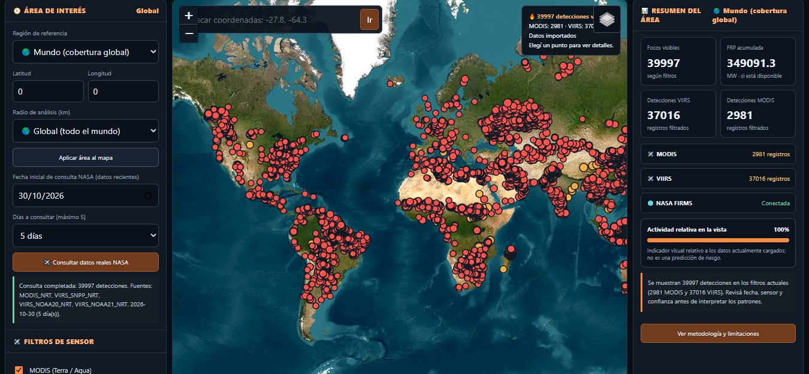

# 🔥 FIREHARMONY

🌐 **Language:** [Español](README.md) | English

<h3 align="center">Satellite fire monitoring through the integration of MODIS and VIIRS data</h3>

<p align="center">
  <strong>Technology, data, and territory to understand and monitor fire activity.</strong>
</p>

<p align="center">
  🛰️ Satellite observation · 🌎 Geospatial analysis · 🔥 Environmental monitoring
</p>

---

## 🌎 Global satellite explorer

🔥 FIREHARMONY is a satellite analysis and monitoring platform focused on visualizing and studying thermal detections associated with fire activity.

The project integrates data from the **MODIS and VIIRS** sensors, part of NASA's Earth-observation systems, to support spatial and temporal analysis of detections.

<p align="center">
  
</p>

<p align="center">
  <em>Map view from the FIREHARMONY application.</em>
</p>

---

## 🎯 Project objectives

- Integrate satellite data from MODIS and VIIRS.
- Normalize and organize records from different sensors.
- Display thermal detections on an interactive map.
- Analyze the geographic distribution and temporal evolution of fire activity.
- Compare data from different satellite platforms.
- Identify clusters and potential related events.
- Support data exploration and export.

## 🛰️ Data sources

The main data source is **NASA FIRMS (Fire Information for Resource Management System)**.

| Sensor | Description |
|---|---|
| MODIS | Instruments aboard the Terra and Aqua satellites. |
| VIIRS | Instruments aboard Suomi-NPP, NOAA-20, and NOAA-21. |

The integration accounts for differences between the sensors, their observation characteristics, and their periods of availability.

## 🧠 Harmonization methodology

The project includes a data integration process for organizing records from different sensors.

The workflow includes:

1. **Acquisition:** collecting satellite records.
2. **Preparation:** cleaning and validating the data.
3. **Normalization:** unifying formats and structures.
4. **Integration:** preserving each sensor's source information.
5. **Analysis:** exploring spatial and temporal patterns.
6. **Visualization:** presenting results through maps and charts.

Harmonizing formats and structures does not, by itself, imply physical calibration between sensors.

## 📊 Platform features

The 🔥 FIREHARMONY project envisions:

- 🌍 Geographic visualization of detections.
- 🛰️ Distinguishing MODIS and VIIRS records.
- 📅 Exploring data by time period.
- 📍 Analyzing spatial distribution.
- 📈 Comparing sensors.
- 🔥 Analyzing fire radiative power (FRP).
- 🧩 Studying clusters and potential related events.
- 📥 Exporting data for further analysis.

*Feature availability depends on implementation and connection to real data.*

## 🛠️ Technologies

| Technology | Use |
|---|---|
| Python | Data processing and analysis. |
| Streamlit | Analytical dashboard development. |
| Pandas | Data manipulation and preparation. |
| Plotly | Interactive visualizations. |
| Leaflet | Map visualization. |
| NASA FIRMS | Satellite data source. |
| Git and GitHub | Version control and documentation. |

## 🏗️ Overall architecture

The proposed platform workflow is:

```text
        NASA FIRMS
             |
      +------+------+
      |             |
    MODIS          VIIRS
      |             |
      +------+------+
             |
       Data acquisition
             |
   Processing and cleaning
             |
       Normalization
             |
      Record integration
             |
       Analysis engine
             |
      +------+------+
      |             |
 Interactive     Streamlit
 application     dashboard
      |             |
      +------+------+
             |
   Visualization and analysis
```

## ⚠️ Important considerations

- A satellite detection represents a thermal anomaly and does not necessarily confirm an individual fire.
- Multiple detections close in space and time may correspond to the same event.
- MODIS and VIIRS have different technical characteristics and resolutions.
- Results depend on the quality, availability, and coverage of the source data.
- The platform is intended for monitoring and analysis; it does not replace official emergency systems or on-the-ground verification.

## 🚀 Open the application

<p align="center">
  <a href="URL_PUBLICA_DE_LA_APLICACION">
    
  </a>
</p>

*Replace the link above with the public application URL when it is available.*

## 📂 Repository structure

```text
🔥FIREHARMONY/
│
├── app/
├── dashboard/
├── data/
│   ├── original/
│   └── processed/
│
├── docs/
│   └── capturas/
│       └── mapa-global.png
│
├── src/
├── tests/
│
├── requirements.txt
├── .gitignore
├── README.md
└── README.en.md
```

*The structure may change as the codebase is finalized.*

## 🌱 Impact and purpose

FIREHARMONY has an identity rooted in Argentina and a global technological outlook.

It aims to combine satellite observation, data science, and interactive visualization to support understanding of thermal activity and provide tools for environmental analysis.

📍 Santiago del Estero, Argentina.

## 🔗 Official sources

- [NASA FIRMS](https://firms.modaps.eosdis.nasa.gov/)
- [NASA Earthdata](https://www.earthdata.nasa.gov/)
- [NASA MODIS](https://modis.gsfc.nasa.gov/)
- [NASA VIIRS](https://www.nesdis.noaa.gov/our-satellites/joint-polar-satellite-system)

---

<p align="center">
  🌳 <strong>FIREHAYMONY</strong>
  <br>
  <em>Data that helps us understand and protect our territory.</em>
</p>
