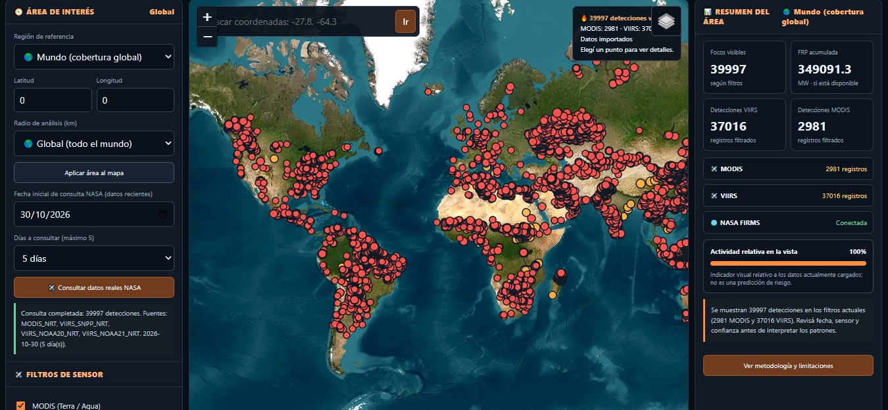

# 🔥 FIREHARMONY

🌐 **Idioma:** Español | [English](README.en.md)

<h3 align="center">Monitoreo satelital de incendios mediante integración de datos MODIS y VIIRS</h3>

<p align="center">
  <strong>Tecnología, datos y territorio para comprender y monitorear la actividad de fuego.</strong>
</p>

<p align="center">
  🛰️ Observación satelital · 🌎 Análisis geoespacial · 🔥 Monitoreo ambiental
</p>

---

## 🌎 Explorador satelital global

🔥 FIREHARMONY es una plataforma de análisis y monitoreo satelital orientada a la visualización y el estudio de detecciones térmicas asociadas a actividad de fuego.

El proyecto integra información de los sensores **MODIS y VIIRS**, pertenecientes a los sistemas de observación de la Tierra de la NASA, para facilitar el análisis espacial y temporal de las detecciones.

<p align="center">
  
</p>

<p align="center">
  <em>Vista del mapa de la aplicación FIREHARMONY.</em>
</p>

---

## 🎯 Objetivos del proyecto

- Integrar información satelital proveniente de MODIS y VIIRS.
- Normalizar y organizar registros de diferentes sensores.
- Visualizar detecciones térmicas sobre un mapa interactivo.
- Analizar la distribución geográfica y evolución temporal de la actividad de fuego.
- Comparar información proveniente de diferentes plataformas satelitales.
- Identificar concentraciones y posibles eventos relacionados.
- Facilitar la exploración y exportación de datos.

## 🛰️ Fuentes de datos

La fuente principal de información es **NASA FIRMS (Fire Information for Resource Management System)**.

| Sensor | Descripción |
|---|---|
| MODIS | Instrumentos a bordo de los satélites Terra y Aqua. |
| VIIRS | Instrumentos a bordo de Suomi-NPP, NOAA-20 y NOAA-21. |

La integración considera las diferencias entre los sensores, sus características de observación y sus períodos de disponibilidad.

## 🧠 Metodología de armonización

El proyecto contempla un proceso de integración de datos que permite organizar registros provenientes de diferentes sensores.

Las etapas de trabajo incluyen:

1. **Adquisición:** obtención de registros satelitales.
2. **Preparación:** limpieza y validación de los datos.
3. **Normalización:** unificación de formatos y estructuras.
4. **Integración:** conservación de la información de origen de cada sensor.
5. **Análisis:** exploración espacial y temporal.
6. **Visualización:** representación de resultados mediante mapas y gráficos.

La armonización de formatos y estructuras no implica por sí misma una calibración física entre sensores.

## 📊 Funcionalidades de la plataforma

La propuesta de 🔥 FIREHARMONY contempla:

- 🌍 Visualización geográfica de detecciones.
- 🛰️ Diferenciación de registros MODIS y VIIRS.
- 📅 Exploración por períodos temporales.
- 📍 Análisis de distribución espacial.
- 📈 Comparación entre sensores.
- 🔥 Análisis de potencia radiativa del fuego (FRP).
- 🧩 Estudio de concentraciones y posibles eventos relacionados.
- 📥 Exportación de datos para análisis posteriores.

*La disponibilidad de cada funcionalidad depende de su implementación y conexión con los datos reales.*

## 🛠️ Tecnologías utilizadas

| Tecnología | Aplicación |
|---|---|
| Python | Procesamiento y análisis de datos. |
| METEOMÁTICA | API meteorológica. |
| Pandas | Manipulación y preparación de datos. |
| Plotly | Visualizaciones interactivas. |
| Leaflet | Visualización cartográfica. |
| NASA FIRMS | Fuente de información satelital. |
| Git y GitHub | Control de versiones y documentación. |

## 🏗️ Arquitectura general

El flujo de trabajo propuesto para la plataforma es:

```text
        NASA FIRMS
             |
      +------+------+
      |             |
    MODIS          VIIRS
      |             |
      +------+------+
             |
      Adquisición de datos
             |
      Procesamiento y limpieza
             |
       Normalización
             |
     Integración de registros
             |
      Motor de análisis
             |
      +------+------+
            
       Aplicación     
       interactiva   
                   
      +------+------+
             |
     Visualización y análisis
```

## ⚠️ Consideraciones importantes

- Una detección satelital representa una anomalía térmica y no necesariamente un incendio individual confirmado.
- Varias detecciones cercanas en espacio y tiempo pueden corresponder a un mismo evento.
- MODIS y VIIRS poseen características técnicas y resoluciones diferentes.
- Los resultados dependen de la calidad, disponibilidad y cobertura de los datos de origen.
- La plataforma tiene fines de monitoreo y análisis; no reemplaza los sistemas oficiales de emergencia ni la verificación en terreno.

## 🚀 Acceso a la aplicación

<p align="center">
  <a href="URL_PUBLICA_DE_LA_APLICACION">
    
  </a>
</p>

*Reemplazar el enlace anterior por la dirección pública de la aplicación cuando esté publicada.*

## 📂 Estructura del repositorio

```text
🔥FIREHARMONY/
│
├── app/
├── dashboard/
├── data/
│   ├── original/
│   └── processed/
│
├── docs/
│   └── capturas/
│       └── mapa-global.png
│
├── src/
├── tests/
│
├── requirements.txt
├── .gitignore
├── README.md
└── README.en.md
```

*La estructura se ajustará a la organización definitiva del código.*

## 🌱 Impacto y propósito

FIREHARMONY nace con una identidad vinculada a Argentina con una perspectiva tecnológica de alcance global.

Busca combinar observación satelital, ciencia de datos y visualización interactiva para facilitar la comprensión de la actividad térmica y aportar herramientas para el análisis ambiental.


📍 Santiago del Estero, Argentina.

## 🔗 Fuentes oficiales

- [NASA FIRMS](https://firms.modaps.eosdis.nasa.gov/)
- [NASA Earthdata](https://www.earthdata.nasa.gov/)
- [NASA MODIS](https://modis.gsfc.nasa.gov/)
- [NASA VIIRS](https://www.nesdis.noaa.gov/our-satellites/joint-polar-satellite-system)
- 

---

<p align="center">
  🌳 <strong>FIREHARMONY</strong>
  <br>
  <em>Datos que ayudan a comprender y proteger nuestro territorio.</em>
</p>
